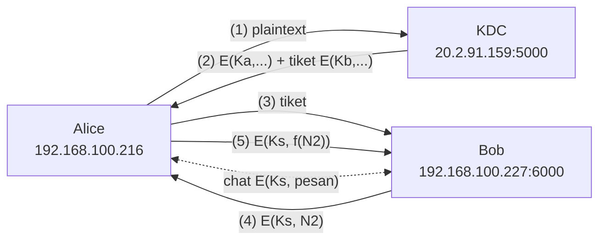
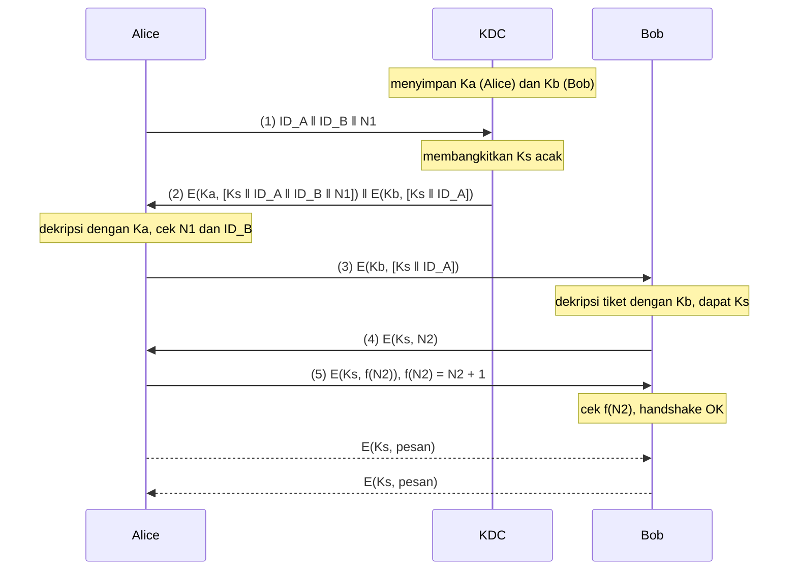
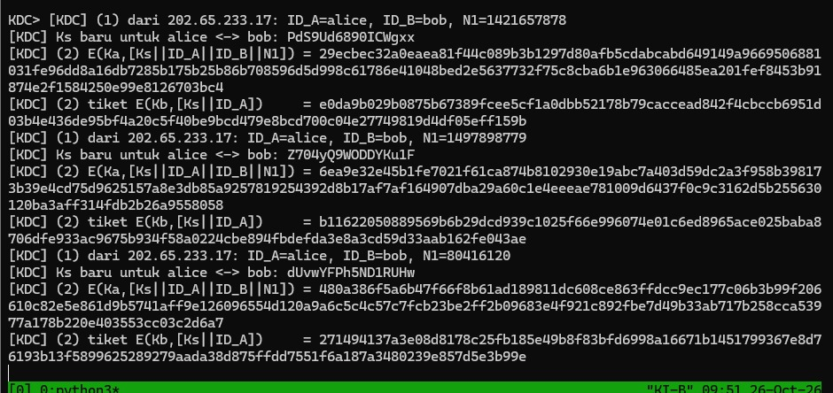
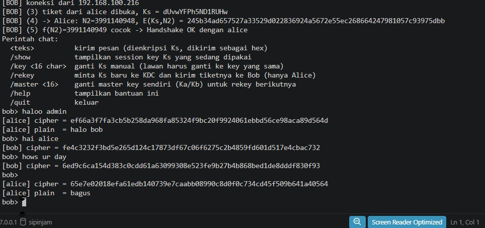
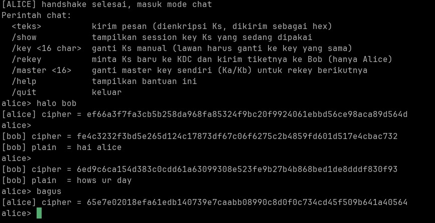
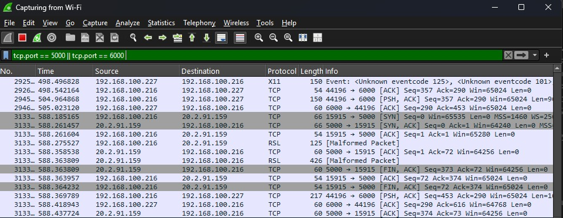
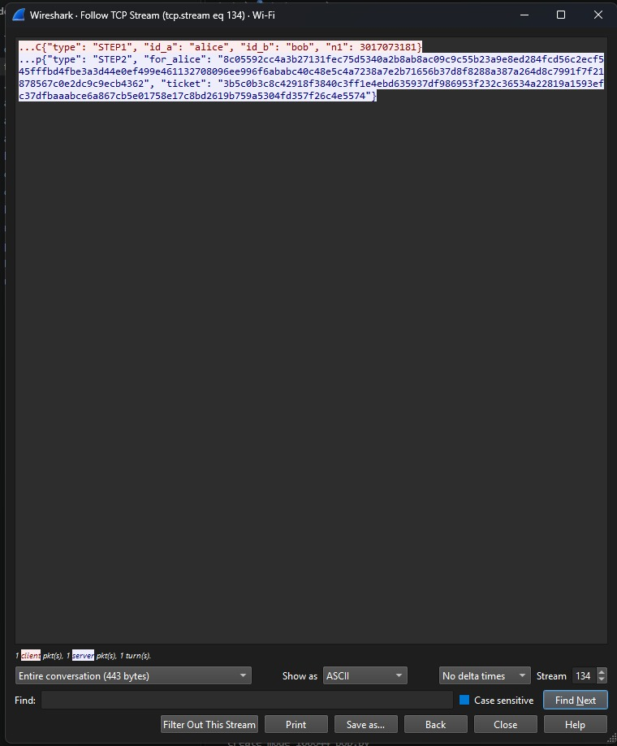
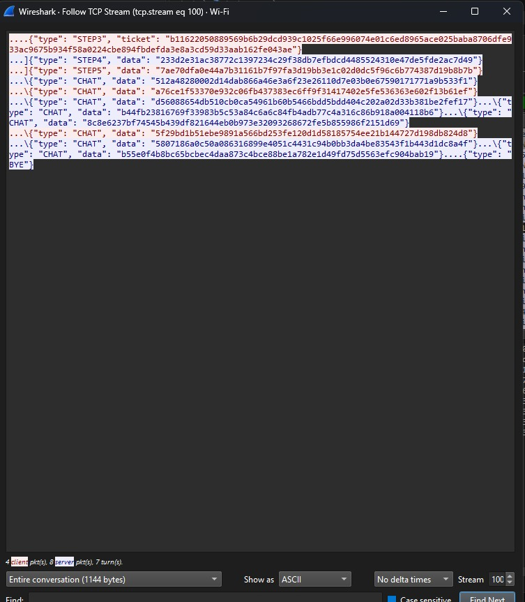

# Laporan Tugas Keamanan Informasi: Key Distribution Center (KDC) + AES-128

| Nama | NRP | Bagian |
| --- | --- | --- |
| Reza Afzaal | 5025241051 | AES-128 manual (`aes.py`, `utils.py`, `aes_cli.py`, `tests/`) |
| Ary Pasya Fernanda | 5025241053 | Jaringan, KDC, handshake, chat (`net.py`, `protocol.py`, `kdc.py`, `alice.py`, `bob.py`, `chat.py`) |

## Daftar isi

1. [Deskripsi tugas](#1-deskripsi-tugas)
2. [Lingkungan pengujian](#2-lingkungan-pengujian)
3. [Arsitektur dan struktur program](#3-arsitektur-dan-struktur-program)
4. [Skenario key distribution](#4-skenario-key-distribution)
5. [Implementasi AES-128](#5-implementasi-aes-128)
6. [Implementasi jaringan dan KDC](#6-implementasi-jaringan-dan-kdc)
7. [Cara menjalankan](#7-cara-menjalankan)
8. [Hasil pengujian](#8-hasil-pengujian)
9. [Analisis keamanan dan keterbatasan](#9-analisis-keamanan-dan-keterbatasan)
10. [Pembagian kerja](#10-pembagian-kerja)
11. [Kesimpulan](#11-kesimpulan)

---

## 1. Deskripsi tugas

Tugas ini mengimplementasikan skenario *key distribution* dengan tiga entitas, yaitu **KDC**, **Alice**, dan **Bob**, yang berjalan di tiga alamat IP berbeda. KDC membagikan *session key* (Ks) kepada Alice dan Bob tanpa pernah mengirim Ks dalam bentuk terbuka. Setelah langkah ke-5, Alice dan Bob berkomunikasi dua arah dengan pesan yang dienkripsi AES-128 menggunakan Ks.

Ketentuan yang dipenuhi:

| Ketentuan | Pemenuhan |
| --- | --- |
| 3 entitas di 3 IP berbeda | Alice `192.168.100.216`, Bob `192.168.100.227`, KDC `20.2.91.159` (bagian 2) |
| Skenario key distribution 5 langkah | `kdc.py`, `alice.py`, `bob.py` (bagian 4) |
| Komunikasi dua arah | Alice dan Bob sama-sama bisa mengirim dan menerima (`chat.py`) |
| Key dan plaintext ASCII, ciphertext hex | Divalidasi di `utils.py`, ciphertext dikirim dan ditampilkan dalam hex |
| AES dan KDC manual | Tidak memakai library kriptografi; AES ditulis dari S-box sampai mode CBC |
| Key tidak di-*hardcode*, bisa diubah tanpa restart | Master key diisi saat runtime; perintah `add`, `/key`, `/rekey`, `/master` |
| Wireshark | Paket diamati dengan filter `tcp.port == 5000 \|\| tcp.port == 6000` (bagian 8) |

## 2. Lingkungan pengujian

| Entitas | Alamat IP | Port | Perangkat |
| --- | --- | --- | --- |
| KDC | `20.2.91.159` | 5000 | Server Linux (VM cloud), dijalankan di tmux |
| Bob | `192.168.100.227` | 6000 | Laptop Windows, jaringan Wi-Fi lokal |
| Alice | `192.168.100.216` | - (client) | Laptop Windows, jaringan Wi-Fi lokal |

Bahasa: Python 3, tanpa library pihak ketiga. Modul standar yang dipakai hanya `socket`, `threading`, `json`, `struct`, `secrets`, dan `os`.

Karena KDC berada di internet, KDC melihat Alice dengan IP publik hasil NAT router (`202.65.233.17`, terlihat di log KDC), bukan IP lokalnya. Bob berada di jaringan lokal yang sama dengan Alice, sehingga Bob melihat IP lokal Alice (`192.168.100.216`).

## 3. Arsitektur dan struktur program



Arsitektur yang dipakai adalah client-server. KDC dan Bob berperan sebagai server (mendengarkan di port 5000 dan 6000), sedangkan Alice berperan sebagai inisiator. Setelah koneksi Alice–Bob terbentuk, kedua pihak setara: masing-masing bisa menjadi pengirim maupun penerima.

| File | Isi |
| --- | --- |
| `aes.py` | AES-128 manual: tabel S-box dan Rcon, key expansion, 4 transformasi round beserta inversenya, PKCS#7, mode CBC, API `encrypt`/`decrypt` |
| `utils.py` | Validasi key (16 karakter ASCII), konversi ASCII dan hex |
| `aes_cli.py` | Tester AES interaktif di luar skenario chat |
| `tests/test_aes.py` | 12 unit test, termasuk test vector FIPS-197 Appendix C.1 |
| `net.py` | Framing pesan TCP: 4 byte panjang + JSON |
| `protocol.py` | Tipe pesan, pembangkit nonce dan Ks, pembacaan config, helper input |
| `kdc.py` | Server KDC: registry master key dan langkah 1–2 |
| `alice.py` | Inisiator: langkah 1, 2, 3, 5 |
| `bob.py` | Responder: langkah 3, 4, 5 |
| `chat.py` | Chat dua arah terenkripsi Ks dan perintah pengelolaan key |
| `docs/wireshark.md` | Panduan capture Wireshark untuk demo |

## 4. Skenario key distribution



| Langkah | Arah | Pesan | Tujuan |
| --- | --- | --- | --- |
| 1 | Alice → KDC | `ID_A ‖ ID_B ‖ N1` (plaintext) | Meminta session key untuk berkomunikasi dengan Bob. N1 adalah nonce acak 32 bit. |
| 2 | KDC → Alice | `E(Ka,[Ks ‖ ID_A ‖ ID_B ‖ N1]) ‖ E(Kb,[Ks ‖ ID_A])` | Bagian pertama hanya bisa dibuka Alice. Adanya N1 membuktikan balasan ini untuk permintaan yang sekarang, bukan rekaman lama. ID_B memastikan permintaan di langkah 1 tidak diubah penyerang. Bagian kedua adalah tiket untuk Bob. |
| 3 | Alice → Bob | `E(Kb,[Ks ‖ ID_A])` | Alice meneruskan tiket tanpa bisa membaca isinya, karena tidak tahu Kb. Bob membukanya dengan Kb dan mendapat Ks serta identitas Alice. |
| 4 | Bob → Alice | `E(Ks, N2)` | Tantangan dari Bob: hanya pemegang Ks yang bisa membuka N2. |
| 5 | Alice → Bob | `E(Ks, f(N2))` | Alice membuktikan dirinya memegang Ks. Nilai N2 harus diubah (N2 + 1); kalau ciphertext dikirim balik apa adanya, penyerang bisa melakukannya tanpa tahu Ks. |

Setiap pengecekan yang gagal menghentikan proses dengan pesan error yang jelas, bukan traceback: N1 tidak cocok, ID tidak sesuai, tiket tidak bisa dibuka, atau f(N2) salah.

Representasi `‖` (konkatenasi) diimplementasikan sebagai objek JSON, misalnya `{"ks": ..., "id_a": ..., "id_b": ..., "n1": ...}`. JSON itu lalu dienkripsi utuh sebagai satu plaintext ASCII. Dengan cara ini setiap field punya batas yang jelas, tidak ambigu seperti konkatenasi string mentah.

## 5. Implementasi AES-128

AES-128 diimplementasikan manual di `aes.py`, tanpa library kriptografi.

**Key expansion.** Key 16 byte diperluas menjadi 44 word (11 round key) memakai `RotWord`, `SubWord`, dan `Rcon`. Hasilnya diverifikasi dengan `w[43] = b6630ca6` sesuai contoh FIPS-197.

**Enkripsi satu blok (10 round).**

```
AddRoundKey(0)
round 1..9 : SubBytes → ShiftRows → MixColumns → AddRoundKey
round 10   : SubBytes → ShiftRows → AddRoundKey
```

- `SubBytes` mensubstitusi tiap byte dengan S-box.
- `ShiftRows` menggeser baris ke-r ke kiri sebanyak r posisi.
- `MixColumns` mengalikan tiap kolom dengan matriks tetap di GF(2⁸), dengan `xtime` untuk perkalian 2.
- `AddRoundKey` meng-XOR state dengan round key.

**Dekripsi** memakai urutan kebalikannya: `InvShiftRows`, `InvSubBytes`, `AddRoundKey`, dan `InvMixColumns`, dengan perkalian umum `gmul` untuk koefisien 9, 11, 13, dan 14.

**Mode CBC dan padding.** Pesan bisa lebih panjang dari 16 byte, sehingga dipakai:

- **PKCS#7** untuk menggenapkan plaintext ke kelipatan 16 byte. Saat dekripsi, padding divalidasi; key yang salah hampir selalu menghasilkan padding tidak valid dan ditolak.
- **CBC dengan IV acak 16 byte** (`os.urandom`) untuk setiap enkripsi: `Cᵢ = E(K, Pᵢ ⊕ Cᵢ₋₁)`, dengan `C₀ = IV`. Akibatnya plaintext yang sama menghasilkan ciphertext yang berbeda setiap kali dikirim.

**Format data.** Key dan plaintext berupa ASCII (key tepat 16 karakter). Ciphertext dikirim dan ditampilkan sebagai hex dengan format `IV ‖ ciphertext`. Contohnya, pesan `halo bob` (8 byte) menjadi 1 blok setelah padding, sehingga hasilnya 16 byte IV + 16 byte ciphertext = 32 byte = **64 karakter hex**, sesuai yang terlihat di gambar 8.2.

**Verifikasi.** `tests/test_aes.py` berisi 12 test: test vector FIPS-197 Appendix C.1 untuk enkripsi dan dekripsi blok (key `000102…0f`, plaintext `00112233…ff`, ciphertext `69c4e0d8…c55a`), test vector CBC NIST SP 800-38A, padding PKCS#7, enkripsi-dekripsi bolak-balik multi-blok, IV yang selalu acak, penolakan key salah, serta penolakan input yang tidak valid. Semua test lulus:

```
python -m unittest discover -s tests
```

## 6. Implementasi jaringan dan KDC

**Framing pesan (`net.py`).** TCP adalah aliran byte, bukan kumpulan pesan: dua `send` bisa tiba sebagai satu `recv`, dan satu pesan besar bisa terpotong. Karena itu setiap pesan dikirim sebagai **4 byte panjang (big-endian, `!I`) diikuti JSON**. Penerima membaca tepat 4 byte, lalu membaca tepat sebanyak panjang tersebut lewat `recv_exact`. Byte panjang ini terlihat sebagai karakter `....` di awal setiap pesan pada Follow TCP Stream Wireshark.

**Nonce dan session key (`protocol.py`).** N1, N2, dan Ks dibangkitkan dengan modul `secrets` (CSPRNG dari OS), bukan `random`, karena keluaran `random` (Mersenne Twister) bisa diprediksi. Ks berupa 16 karakter ASCII acak dari huruf dan angka.

**KDC (`kdc.py`).**
- Master key **tidak di-hardcode**. Key didaftarkan saat runtime lewat menu `add <id> <key>` dan bisa diganti atau dihapus kapan saja tanpa restart (`add`, `del`, `list`).
- Setiap koneksi ditangani di thread terpisah, sehingga KDC bisa melayani beberapa permintaan sekaligus. Registry key dilindungi `threading.Lock` karena diakses bersamaan oleh menu dan handler.
- ID yang tidak terdaftar dibalas pesan `ERROR`, tanpa crash.

**Chat (`chat.py`).** Program memakai dua thread: thread utama membaca input dan mengirim, sedangkan thread penerima terus menerima di belakang. Tanpa pemisahan ini, `input()` akan memblokir program dan pesan dari lawan tidak bisa diterima sambil mengetik. Ks aktif disimpan dalam objek bersama yang dilindungi lock.

| Perintah | Fungsi |
| --- | --- |
| `<teks>` | Kirim pesan terenkripsi Ks |
| `/show` | Tampilkan Ks aktif |
| `/key <16 char>` | Ganti Ks manual (lawan harus mengganti ke nilai yang sama) |
| `/rekey` | Alice meminta Ks baru ke KDC (ulang langkah 1–2), lalu mengirim tiket baru ke Bob |
| `/master <16 char>` | Ganti master key sendiri (Ka/Kb) untuk rekey berikutnya |
| `/quit` | Keluar dan memberi tahu lawan (pesan `BYE`) |

## 7. Cara menjalankan

Kebutuhan: Python 3.10+ tanpa library tambahan. Izinkan port 5000 (KDC) dan 6000 (Bob) di firewall.

**KDC**
```
python kdc.py
Host bind [0.0.0.0]:
Port [5000]:
KDC> add alice <Ka, 16 karakter ASCII>
KDC> add bob <Kb, 16 karakter ASCII>
```

**Bob**
```
python bob.py
ID Bob [bob]:
Master key Kb (16 karakter ASCII): <Kb>
```

**Alice**
```
python alice.py
ID Alice [alice]:
Master key Ka (16 karakter ASCII): <Ka>
IP KDC [...]: 20.2.91.159
IP Bob [...]: 192.168.100.227
```

Setelah handshake selesai, Alice dan Bob otomatis masuk mode chat. IP bawaan bisa diatur di `config.json` (salin dari `config.example.json`).

## 8. Hasil pengujian

### 8.1 KDC



KDC menerima tiga permintaan dari Alice (IP publik `202.65.233.17`). Untuk setiap permintaan, KDC membangkitkan Ks baru yang berbeda dan mengirim dua ciphertext hex: `E(Ka,...)` untuk Alice dan tiket `E(Kb,...)` untuk Bob. Permintaan ketiga menghasilkan Ks `dUvwYFPh5ND1RUHw`.

### 8.2 Bob dan Alice: handshake dan chat dua arah





Hal yang terbukti dari kedua gambar:

- **Langkah 3:** Bob membuka tiket dan mendapat Ks `dUvwYFPh5ND1RUHw`. Nilai ini sama persis dengan Ks yang dibuat KDC pada permintaan ketiga (gambar 8.1), padahal Ks tidak pernah dikirim dalam bentuk terbuka.
- **Langkah 4–5:** Bob mengirim N2 = `3991140948`, menerima f(N2) = `3991140949` = N2 + 1, lalu menyatakan `Handshake OK dengan alice`.
- **Bob melihat koneksi dari `192.168.100.216`**, yaitu laptop Alice. Ini menegaskan Alice dan Bob berada di perangkat yang berbeda.
- **Chat dua arah:**

  | Pengirim | Plaintext | Ciphertext (hex) |
  | --- | --- | --- |
  | Alice → Bob | `halo bob` | `ef66a3f7fa3cb5b2…ca89d564d` |
  | Bob → Alice | `hai alice` | `fe4c3232f3bd5e26…7e4cbac732` |
  | Bob → Alice | `hows ur day` | `6ed9c6ca154d383c…e8dddf830f93` |
  | Alice → Bob | `bagus` | `65e7e02018efa61e…509b641a40564` |

  Ciphertext yang dicetak pengirim sama persis dengan yang diterima lawan, dan penerima berhasil mendekripsinya kembali menjadi plaintext semula.

### 8.3 Capture Wireshark



Capture dilakukan di interface Wi-Fi dengan filter `tcp.port == 5000 || tcp.port == 6000`. Terlihat dua jalur komunikasi:

- `192.168.100.216` (Alice) ↔ `20.2.91.159:5000` (KDC): langkah 1–2, diawali three-way handshake TCP (SYN, SYN-ACK, ACK) dan diakhiri FIN.
- `192.168.100.216` (Alice) ↔ `192.168.100.227:6000` (Bob): langkah 3–5 dan chat.

Wireshark memberi label **X11** pada port 6000 dan **RSL [Malformed Packet]** pada port 5000. Label itu hanya tebakan Wireshark berdasarkan nomor port standar (6000 adalah port default X11). Isi paketnya tetap protokol buatan kami (4 byte panjang + JSON), seperti terlihat di Follow TCP Stream berikut.

### 8.4 Langkah 1–2 (Alice ↔ KDC)



- **Langkah 1 (merah, Alice → KDC):** `{"type": "STEP1", "id_a": "alice", "id_b": "bob", "n1": 3017073181}` terbaca jelas. Ini memang sesuai skenario, karena langkah 1 dikirim tanpa enkripsi dan hanya berisi identitas dan nonce, bukan rahasia.
- **Langkah 2 (biru, KDC → Alice):** `for_alice` dan `ticket` hanya berupa hex. Ks tidak terlihat di paket.

### 8.5 Langkah 3–5 dan chat (Alice ↔ Bob)



- **Langkah 3:** tiket `b11622050889569b6b29…3cd59d33aab162fe043ae` sama persis dengan tiket yang dicetak KDC pada permintaan kedua (gambar 8.1). Ini membuktikan Alice meneruskan tiket tanpa mengubahnya, karena memang tidak bisa membacanya.
- **Langkah 4 dan 5:** `data` hanya berupa hex. N2 dan N2 + 1 tidak terlihat.
- **Chat:** semua pesan bertipe `CHAT` dengan `data` hex. Isi percakapan sama sekali tidak terbaca. Yang terlihat terbuka hanya tipe pesan dan pesan penutup `BYE`.

### 8.6 Ringkasan test case

| No | Skenario | Hasil yang diharapkan | Hasil |
| --- | --- | --- | --- |
| 1 | Unit test AES (FIPS-197 C.1, NIST SP 800-38A, PKCS#7, IV acak, key salah) | 12 test lulus | Lulus |
| 2 | Handshake normal di 3 IP | `Handshake OK`, Ks Alice = Ks Bob = Ks dari KDC | Lulus (8.1, 8.2) |
| 3 | Chat Alice → Bob dan Bob → Alice | Pesan terkirim sebagai hex dan terdekripsi benar | Lulus (8.2) |
| 4 | Isi paket di Wireshark | Hanya langkah 1 yang plaintext; Ks dan isi chat tidak terlihat | Lulus (8.4, 8.5) |
| 5 | Alice memakai Ka salah | Alice berhenti: `gagal mendekripsi balasan KDC - Ka salah?` | Lulus |
| 6 | KDC dan Bob memakai Kb berbeda | Bob menolak tiket: `tiket tidak valid - Kb salah?` | Lulus |
| 7 | `/key` hanya diganti di satu sisi | Penerima menampilkan `GAGAL dekripsi`, program tidak crash | Lulus |
| 8 | `/rekey` | Ks baru dari KDC, `/show` di Alice dan Bob menampilkan Ks baru yang sama | Lulus |
| 9 | ID tidak terdaftar di KDC | KDC membalas `ERROR`, tanpa crash | Lulus |

## 9. Analisis keamanan dan keterbatasan

**Yang dijamin skenario ini:**
- Ks tidak pernah lewat jaringan dalam bentuk terbuka. Ks selalu dibungkus Ka, Kb, atau dirinya sendiri.
- Alice yakin balasan KDC asli dan baru (N1 cocok, ID_B tidak diubah).
- Bob yakin tiket dibuat KDC (bisa dibuka dengan Kb) dan lawan bicaranya memegang Ks (f(N2) benar).
- IV acak membuat pesan yang sama menghasilkan ciphertext berbeda, sehingga penyadap tidak bisa mengenali pesan yang berulang.

**Keterbatasan:**
- **Replay tiket lama (Denning–Sacco).** Tiket tidak memuat timestamp. Kalau Ks lama pernah bocor, penyerang bisa me-replay tiket lama di langkah 3 dan lolos di langkah 4–5. Perbaikannya adalah menambahkan timestamp ke dalam tiket dan menolak tiket yang kedaluwarsa.
- **Tidak ada integritas pesan.** CBC hanya menjamin kerahasiaan. Ciphertext yang dimodifikasi bisa terdeteksi lewat padding yang rusak, tetapi tidak selalu. Idealnya ditambah MAC (misalnya HMAC) atau memakai mode terautentikasi.
- **Entropi Ks.** Ks dibatasi huruf dan angka ASCII agar sesuai ketentuan format ASCII, sehingga entropinya sekitar 95 bit (16 × log₂62), bukan 128 bit penuh.
- **`/rekey` tidak mengulang langkah 4–5**, sehingga Bob tidak memverifikasi ulang bahwa Alice memegang Ks yang baru.
- **Langkah 1 terbuka**, sehingga penyadap bisa mengetahui siapa yang ingin berkomunikasi dengan siapa. Ini memang bagian dari skenario.

## 10. Pembagian kerja

| Anggota | Tanggung jawab |
| --- | --- |
| Reza | AES-128 manual (key expansion, round functions, enkripsi dan dekripsi blok), PKCS#7, CBC, validasi key, tester AES, unit test FIPS-197 |
| Pasya | Setup repo, framing jaringan, protokol dan pembangkit nonce/Ks, server KDC, handshake Alice–Bob, chat dua arah dan perintah key, panduan Wireshark |
| Bersama | Integrasi, pengujian di 3 perangkat, laporan |

Pengembangan dilakukan di GitHub dengan branch per fitur (`feature/aes-core`, `feature/aes-mode`, `feature/net-kdc`, `feature/handshake`, `feature/chat-cli`, `docs/final`). Setiap fitur digabung ke `main` lewat Pull Request dengan merge commit, sehingga riwayat commit tiap anggota tetap terlihat.

Selama pengembangan, `aes.py` sempat berisi stub dengan nama fungsi dan parameter yang sama (`encrypt(plaintext, key)` dan `decrypt(cipher_hex, key)`). Dengan begitu bagian jaringan dan KDC bisa dikerjakan paralel sambil menunggu AES selesai. Setelah AES asli masuk, kode jaringan tidak perlu diubah sama sekali.

## 11. Kesimpulan

Skenario key distribution dengan KDC berhasil diimplementasikan pada tiga perangkat dengan IP berbeda. Alice dan Bob mendapat session key yang sama dari KDC tanpa Ks pernah terkirim dalam bentuk terbuka, saling memverifikasi lewat nonce N1 dan tantangan N2, lalu berkomunikasi dua arah dengan AES-128 mode CBC yang diimplementasikan secara manual. Pengamatan Wireshark menunjukkan bahwa hanya langkah 1, yang memang plaintext sesuai skenario, yang terbaca, sedangkan Ks, nonce N2, dan isi chat hanya tampil sebagai hex. Key dapat diubah saat program berjalan, dan input key yang salah ditangani dengan pesan error tanpa menghentikan program secara tidak terkendali.
